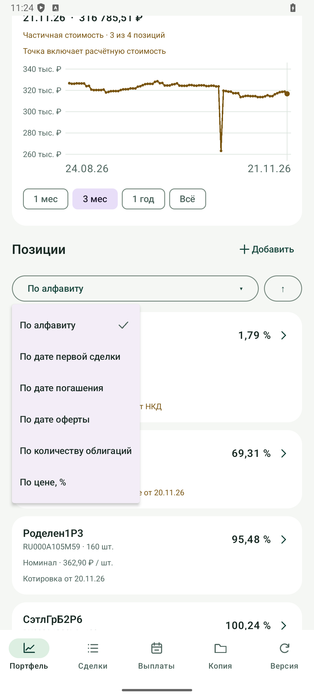
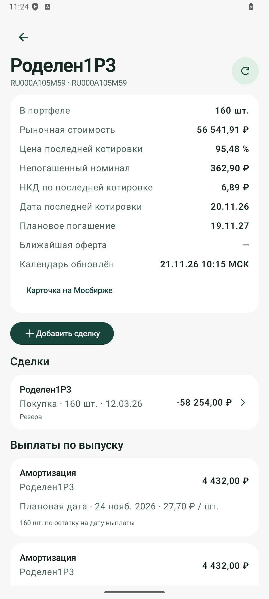
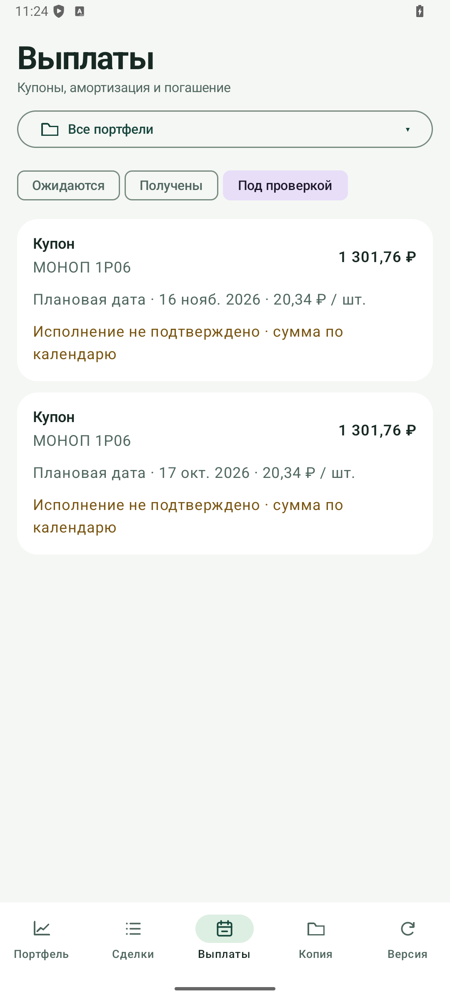
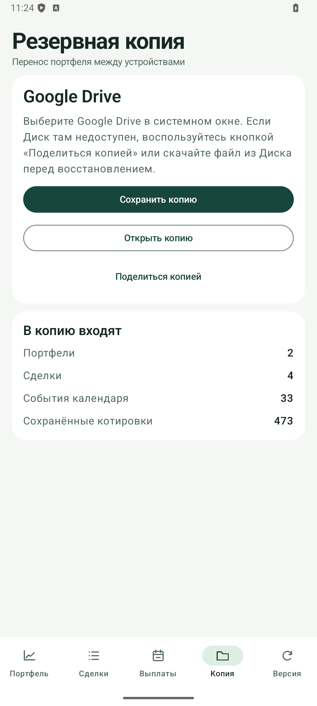

# Бондоскоп (Bondoscope)

Бондоскоп ведёт учёт портфелей рублёвых облигаций Московской биржи на Android 8.0 и новее. В приложении можно записывать покупки и продажи, отслеживать стоимость и финансовый результат, смотреть купоны, амортизацию и погашения. Сделки и загруженные биржевые данные хранятся на устройстве в базе Room и никуда не передаются (кроме выгрузки на Google Drive по требованию пользователя).

[Скачать APK актуальной версии](https://github.com/vovainfo/Bondoscope/releases/latest)

Все скриншоты сделаны в версии 1.4.8 на демонстрационном портфеле. Сделки, количество бумаг и суммы на экранах приведены для примера.

## Быстрый старт

1. На экране «Портфель» выберите существующий портфель или откройте переключатель и нажмите «Новый портфель».
2. Откройте «Сделки → Добавить сделку», найдите облигацию по тикеру или ISIN, укажите количество, дату и цену. Для первичного размещения можно воспользоваться кнопкой **IBO**.
3. Вернитесь в «Портфель» и нажмите кнопку обновления в правом верхнем углу. После загрузки биржевых данных появятся оценка позиций, графики и календарь выплат.

## Портфели и позиции

Переключатель портфеля доступен на экранах «Портфель», «Сделки» и «Выплаты». Режим **«Все портфели»** объединяет позиции, сделки, выплаты и графики. Одну и ту же облигацию можно держать в нескольких портфелях. В общей сводке её количество складывается. Через переключатель можно создать портфель или переименовать выбранный. Сделки из ранних версий приложения без поддержки нескольких портфелей находятся в портфеле «Основной».

В списке **«Позиции»** по каждому выпуску видны тикер, код бумаги, количество, чистая котировка в процентах от номинала, дата котировки и непогашенный номинал на одну облигацию с учётом амортизации. Карточка выпуска раскрывает стоимость позиции, НКД, плановое погашение, ближайшую оферту, сделки и выплаты.

Позиции сортируются по алфавиту, дате первой сделки, дате погашения, ближайшей оферте, количеству бумаг или котировке в процентах. Кнопка **↑/↓** меняет направление. Для даты первой сделки учитывается история выбранного портфеля. При сортировке по дате или цене позиции без соответствующих данных остаются в конце.

| Сводка и график стоимости | Позиции по цене в процентах |
|---|---|
| <a href="docs/screenshots/portfolio.png"></a> | <a href="docs/screenshots/positions.png"></a> |

| Варианты сортировки | Карточка выпуска |
|---|---|
| <a href="docs/screenshots/position-sorting.png"></a> | <a href="docs/screenshots/bond-details.png"></a> |

## Покупки и продажи

В журнале «Сделки» можно добавить покупку или продажу, а также открыть сохранённую операцию для редактирования или удаления. Портфель указывается в редакторе. При переносе сделки можно переместить в другой портфель всю историю этого выпуска. Приложение проверяет, что после операций остаток бумаг в портфеле остаётся допустимым.

Цена задаётся **за одну облигацию**. НКД означает накопленный купонный доход. Поддерживаются три формата цены.

| Формат цены | Что заполнять |
|---|---|
| **% номинала** | Чистую цену в процентах. Для расчёта суммы используются номинал и НКД на дату расчётов или сделки. |
| **В рублях → Без НКД** | Чистую цену в рублях. НКД прибавляется отдельно. |
| **В рублях → С НКД** | Полную цену в рублях с уже включённым НКД. |

В блоке «НКД, комиссия и дата расчётов» можно указать данные из брокерского отчёта. Пустые НКД и номинал приложение подставляет из биржевых данных за нужную дату, когда они доступны. Пустая комиссия считается нулевой. Если в журнале возле сделки стоит прочерк с сообщением о недостающем НКД или номинале, откройте сделку и заполните эти поля по отчёту.

Кнопка **IBO** для покупки ищет дату первых заключённых сделок в режимах первичного размещения. Для новой покупки она предлагает цену 100 % номинала. Дату, цену, количество и комиссию можно сверить с брокерским отчётом и изменить до сохранения.

<a href="docs/screenshots/trade-editor.png"></a>

## Стоимость и финансовый результат

Рыночная стоимость позиции рассчитывается по чистой котировке, актуальному номиналу и НКД на одну бумагу. Финансовый результат учитывает стоимость открытых позиций, поступления от продаж и выплат, расходы на покупки и комиссии. Результат закрытых позиций входит в итог, если известны их сделки и выплаты.

В блоке «Динамика» можно переключать **«Стоимость»** и **«Результат»**, выбирать месяц, три месяца, год или всю историю и нажимать на график для просмотра суммы на нужную дату. По оси Y указаны суммы в рублях.

Если по части бумаг не хватает данных, сводка и график стоимости показывают сумму по доступным позициям. Для частичной точки отображается число вошедших в расчёт позиций. В частичный финансовый результат входит выпуск целиком, когда доступны его оценка и связанные денежные потоки. Через **«Подробности оценки»** можно посмотреть, почему отдельные позиции пропущены или рассчитаны приближённо.

После календарной даты купона Бондоскоп может использовать последнюю чистую цену и расчётный НКД нового периода. Для такой оценки котировке должно быть не больше семи календарных дней, номинал должен совпадать, а данные нового купонного периода должны быть доступны. Приложение отмечает расчётную сумму в сводке, графике и карточке выпуска.

<a href="docs/screenshots/valuation-details.png"></a>

## Купоны, амортизация и погашения

- **«Ожидаются»** показывает будущие купоны и выплаты номинала с плановыми датами.
- **«Получены»** показывает выплаты, учтённые автоматически по календарю, и график с суммами по месяцам. В графике отдельно показаны купоны и возврат номинала. Можно выбрать 6 месяцев, 12 месяцев или весь период. Нажмите на столбец, чтобы увидеть суммы за месяц.
- **«Под проверкой»** показывает наступившие календарные выплаты по выпускам с признаками дефолта или технического дефолта из ISS. Суммы в этом разделе плановые. Они исключаются из полученных выплат, а позиция остаётся открытой после срока неподтверждённого погашения.

Размер выплаты в портфеле рассчитывается по количеству бумаг на дату фиксации. Если её нет в календаре, используется дата выплаты. Для определения остатка используется дата расчётов по сделке, а при её отсутствии — дата сделки. Календарные суммы приведены до индивидуальных удержаний брокера.

Биржевой признак дефолта относится к выпуску в целом. Поэтому под проверку могут попасть и более ранние выплаты по этому выпуску. При снятии признака уже наступившие выплаты остаются под проверкой. Их фактическое зачисление можно сверить с брокерским отчётом.

| График полученных выплат | Выплаты под проверкой |
|---|---|
| <a href="docs/screenshots/payment-history.png"></a> | <a href="docs/screenshots/payment-review.png"></a> |

## Резервная копия и перенос на другое устройство

На экране **«Копия»** можно сохранить, открыть или отправить JSON. Копия включает все портфели, сделки, карточки выпусков, календарные выплаты и сохранённые котировки.

1. Нажмите **«Сохранить копию»** и выберите папку на устройстве или Google Drive в системном окне Android. Если Диск там недоступен, воспользуйтесь кнопкой **«Поделиться копией»**.
2. На другом устройстве нажмите **«Открыть копию»** и выберите тот же JSON с Диска или из локальной папки.
3. Проверьте содержимое копии на экране предварительного просмотра и нажмите **«Восстановить»**. Импорт объединяет данные с локальной базой и проверяет конфликты сделок.

## Обновление приложения и биржевых данных

В разделе **«Версия»** нажмите **«Проверить обновления»**. Если доступен новый релиз, скачайте его и нажмите «Установить обновление». При первом обновлении Android может попросить разрешить Бондоскопу установку из этого источника. Установщик запросит подтверждение.

Кнопка обновления на главном экране загружает биржевые данные для портфеля. В карточке выпуска такая же кнопка обновляет выбранную бумагу. Приложение также планирует фоновые обновления при доступной сети. Котировки, даты оферт, календарь и признаки дефолта загружаются из информационно-статистического сервера Московской биржи. [MOEX ISS](https://www.moex.com/a2193)

| Резервная копия | Проверка обновлений |
|---|---|
| <a href="docs/screenshots/backup.png"></a> | <a href="docs/screenshots/updates.png"></a> |

## Сборка

Откройте проект в Android Studio с Android SDK 36, Build Tools 36.1.0 и JDK 17 или 21. SDK задаётся через `ANDROID_HOME` или в `local.properties`, который Studio создаёт при открытии проекта.

```powershell
.\gradlew.bat :app:assembleDebug :app:testDebugUnitTest
```

APK находится в `app/build/outputs/apk/debug/app-debug.apk`.

### Публикация релиза

Увеличьте `versionCode` и `versionName`. Прикрепите к релизу `v<versionName>` файл `Bondoscope-<versionName>.apk`, подписанный тем же ключом, что и предыдущие версии.

При ограничении API GitHub приложение читает файл `bondoscope-update.json` из последнего релиза. Включите в него поля `tag_name`, `draft`, `prerelease` и массив `assets` с записью APK. Для APK нужны поля `name`, `state` (`uploaded`), `size` в байтах, `digest` в формате `sha256:<хеш>` и `browser_download_url`.
