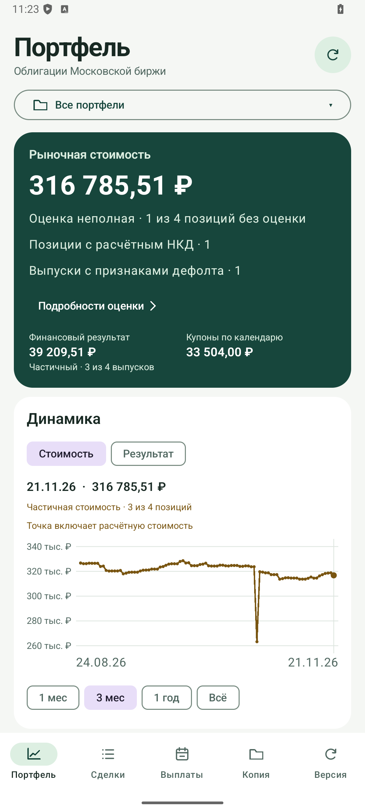
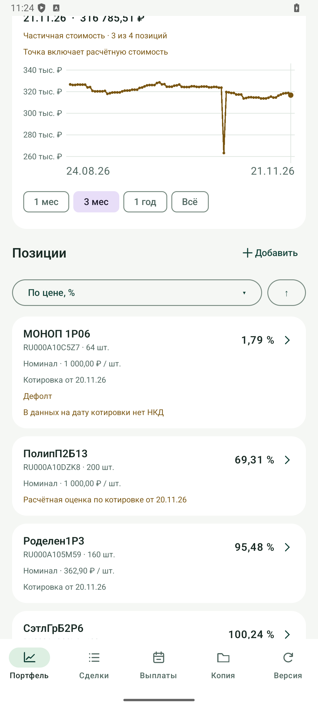
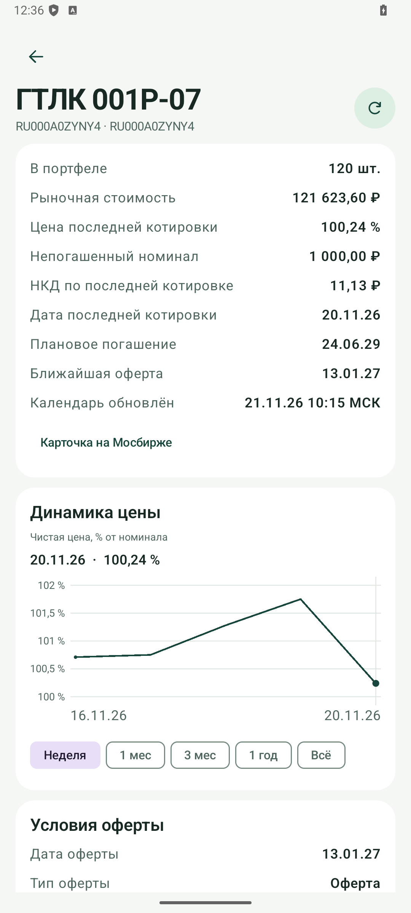
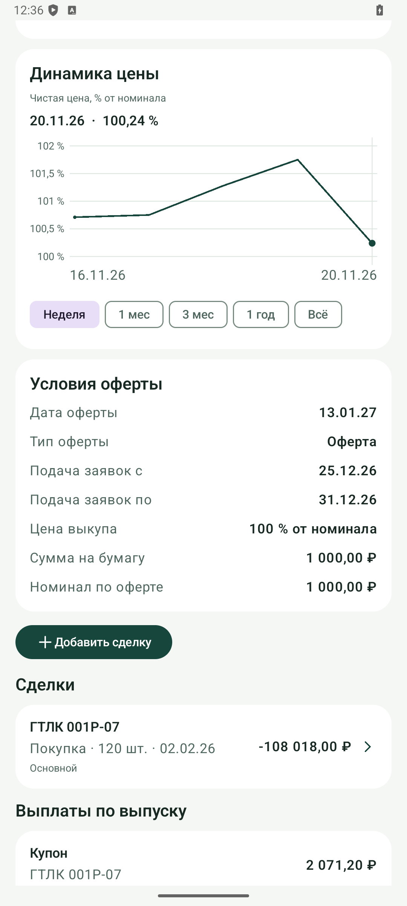
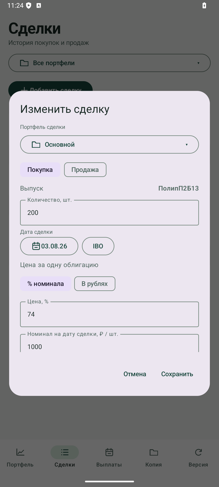
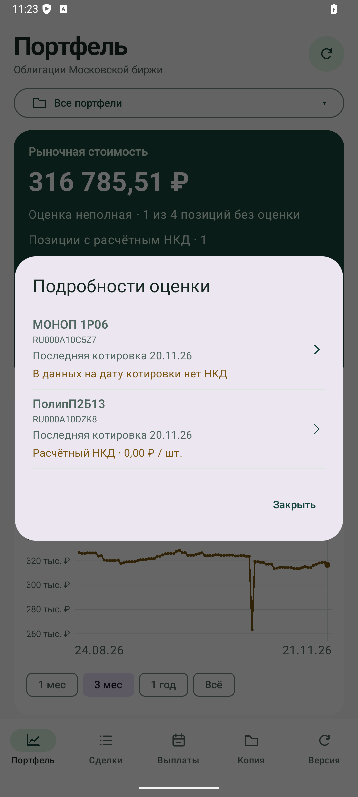
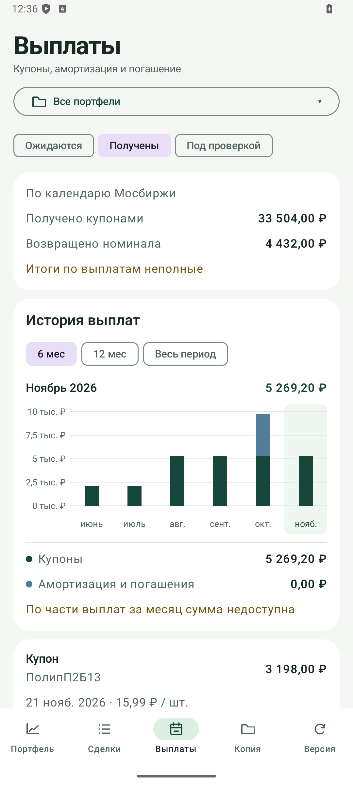
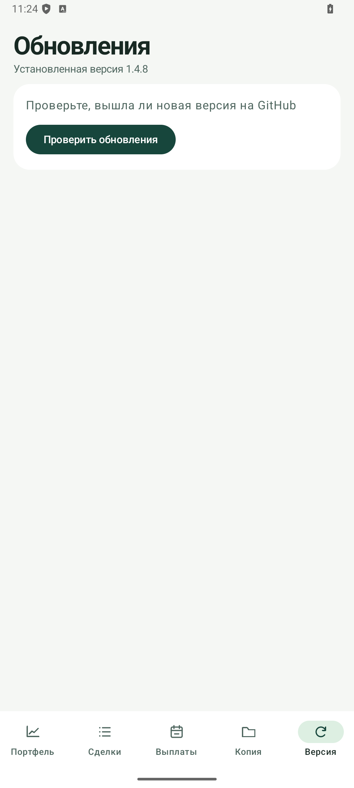

# Бондоскоп (Bondoscope)

Бондоскоп ведёт учёт портфелей рублёвых облигаций Московской биржи на Android 8.0 и новее. В приложении можно записывать покупки и продажи, отслеживать стоимость и финансовый результат, смотреть купоны, амортизацию и погашения. Портфели, сделки и загруженные биржевые данные хранятся на устройстве. Для переноса данных можно сохранить резервную копию JSON на Google Drive или отправить её через системное меню Android.

[Скачать APK актуальной версии](https://github.com/vovainfo/Bondoscope/releases/latest)

Скриншоты сделаны в версии 1.4.9 на демонстрационном портфеле. Сделки, количество бумаг и суммы на экранах приведены для примера.

## Быстрый старт

1. На экране «Портфель» выберите существующий портфель или откройте переключатель и нажмите «Новый портфель».
2. Откройте «Сделки → Добавить сделку», найдите облигацию по тикеру или ISIN, укажите количество, дату и цену. Для первичного размещения можно воспользоваться кнопкой **IBO**.
3. Вернитесь в «Портфель» и нажмите кнопку обновления в правом верхнем углу. После загрузки биржевых данных появятся оценка позиций, графики и календарь выплат.

## Портфели и позиции

Переключатель портфеля доступен на экранах «Портфель», «Сделки» и «Выплаты». Режим **«Все портфели»** объединяет позиции, сделки, выплаты и графики. Одну и ту же облигацию можно держать в нескольких портфелях. В общей сводке её количество складывается. Через переключатель можно создать портфель или переименовать выбранный. Сделки из ранних версий приложения без поддержки нескольких портфелей находятся в портфеле «Основной».

В списке **«Позиции»** по каждому выпуску видны тикер, код бумаги, количество, чистая котировка в процентах от номинала, дата котировки и непогашенный номинал на одну облигацию с учётом амортизации. При наличии двух цен под котировкой показано изменение в процентных пунктах с датой предыдущей доступной котировки. Рост выделен зелёным, снижение красным.

Позиции сортируются по алфавиту, дате первой сделки, дате погашения, ближайшей оферте, количеству бумаг или котировке в процентах. Кнопка **↑/↓** меняет направление. Для даты первой сделки учитывается история выбранного портфеля. При сортировке по дате или цене позиции без соответствующих данных остаются в конце.

| Сводка и график за неделю | Позиции с изменением цены |
|---|---|
| <a href="docs/screenshots/portfolio.png"></a> | <a href="docs/screenshots/positions.png"></a> |

| Варианты сортировки | Сводка по выпуску |
|---|---|
| <a href="docs/screenshots/position-sorting.png"></a> | <a href="docs/screenshots/bond-details.png"></a> |

## Карточка выпуска

Откройте позицию, чтобы посмотреть рыночную стоимость, НКД, непогашенный номинал, дату погашения и ближайшую оферту. В карточке также видны сделки и выплаты по выпуску.

В разделе **«Выплаты по выпуску»** вкладка **«Планируемые»** показывает будущие выплаты от ближайшей даты к дальней, а **«Прошедшие»** — выплаты с наступившей датой, начиная с самых свежих. У каждой вкладки свой фильтр **«Все»**, **«Купоны»** или **«Амортизация и погашение»**. В прошедших выплатах по выпускам с признаками дефолта сохраняется отметка о неподтверждённом исполнении.

График **«Динамика цены»** показывает чистую цену в процентах от номинала. Доступны неделя, месяц, три месяца, год и вся загруженная история. Период отсчитывается от последней котировки. Нажмите на график, чтобы увидеть цену на выбранную дату.

В блоке **«Условия оферты»** показаны опубликованные Мосбиржей условия ближайшей оферты. Это могут быть тип, начало и конец подачи заявок, цена выкупа в процентах от номинала, сумма на бумагу, номинал в его валюте и агент. Если биржа опубликовала только дату, она видна в сводке карточки. После установки 1.4.9 нажмите кнопку обновления в карточке, чтобы загрузить недостающие условия оферты и историю котировок. [Календарь Мосбиржи](https://www.moex.com/ru/bondization/calendar)

| График чистой цены | Условия ближайшей оферты |
|---|---|
| <a href="docs/screenshots/bond-price.png"></a> | <a href="docs/screenshots/bond-offer.png"></a> |

## Покупки и продажи

В журнале «Сделки» можно добавить покупку или продажу, а также открыть сохранённую операцию для редактирования или удаления. Портфель указывается в редакторе. При переносе сделки можно переместить в другой портфель всю историю этого выпуска. Приложение проверяет, что после операций остаток бумаг в портфеле остаётся допустимым.

Цена задаётся **за одну облигацию**. НКД означает накопленный купонный доход. Поддерживаются три формата цены.

| Формат цены | Что заполнять |
|---|---|
| **% номинала** | Чистую цену в процентах. Для расчёта суммы используются номинал и НКД на дату расчётов или сделки. |
| **В рублях → Без НКД** | Чистую цену в рублях. НКД прибавляется отдельно. |
| **В рублях → С НКД** | Полную цену в рублях с уже включённым НКД. |

В блоке «НКД, комиссия и дата расчётов» можно указать данные из брокерского отчёта. Пустые НКД и номинал приложение подставляет из биржевых данных за нужную дату, когда они доступны. Пустая комиссия считается нулевой. Если в журнале возле сделки стоит прочерк с сообщением о недостающем НКД или номинале, откройте сделку и заполните эти поля по отчёту.

Кнопка **IBO** для покупки ищет дату первых заключённых сделок в режимах первичного размещения. Для новой покупки она предлагает цену 100 % номинала. Дату, цену, количество и комиссию можно сверить с брокерским отчётом и изменить до сохранения.

<a href="docs/screenshots/trade-editor.png"></a>

## Стоимость и финансовый результат

В сводке показаны рыночная стоимость с НКД и отдельная сумма без НКД. Чистая стоимость рассчитывается по котировке в процентах, оставшемуся номиналу и количеству бумаг. Финансовый результат учитывает стоимость открытых позиций, поступления от продаж и выплат, расходы на покупки и комиссии. Результат закрытых позиций входит в итог, если известны их сделки и выплаты.

Под рыночной стоимостью показано **«Отклонение от номинала без НКД»**. Из чистой рыночной стоимости каждой позиции вычитается её оставшийся номинал с учётом амортизации. Дневное изменение этой суммы сравнивает две последние даты с котировками. Если данных хватает только по части позиций, указано, сколько удалось сравнить.

Нажмите на дневное изменение, чтобы открыть список выпусков. Строки отсортированы от наибольшего изменения чистой цены по модулю. Процент рассчитывается относительно предыдущей чистой котировки. В списке также видны вклад выпуска в изменение суммы, изменения количества и номинала, а также амортизация по календарю.

В блоке «Динамика» можно переключать **«Стоимость без НКД»** и **«Результат»**, выбирать неделю, месяц, три месяца, год или всю историю и нажимать на график для просмотра суммы на нужную дату. По оси Y указаны суммы в рублях. Ссылка **«Подробнее»** под графиком стоимости сравнивает первую и последнюю доступные оценки за выбранный период. В списке выпусков видны изменение чистой котировки в процентных пунктах, вклад в изменение стоимости и амортизация. Список можно отсортировать по модулю изменения в процентных пунктах или в рублях.

Если по части бумаг не хватает данных, сводка и график стоимости показывают сумму по доступным позициям. В частичный финансовый результат входит выпуск целиком, когда доступны его оценка и связанные денежные потоки. Нажмите на пометку **«Частичный»** в сводке или на графике, чтобы увидеть выпуски, которые пропущены в расчёте, и причины. Через **«Подробности оценки»** в сводке также видны позиции с расчётным НКД.

После календарной даты купона Бондоскоп может использовать последнюю чистую цену и расчётный НКД нового периода. Для оценки с расчётным НКД котировке должно быть не больше семи календарных дней, номинал должен совпадать, а данные нового купонного периода должны быть доступны. Приложение отмечает такую оценку в сводке, графике результата и карточке выпуска.

<a href="docs/screenshots/valuation-details.png"></a>

## Купоны, амортизация и погашения

- **«Ожидаются»** показывает будущие купоны и выплаты номинала с плановыми датами.
- **«Получены»** показывает выплаты, учтённые автоматически по календарю, и график с суммами по месяцам. В графике отдельно показаны купоны и возврат номинала. Можно выбрать 6 месяцев, 12 месяцев или весь период. Нажмите на столбец, чтобы увидеть суммы за месяц.
- **«Под проверкой»** показывает наступившие календарные выплаты по выпускам с признаками дефолта или технического дефолта из ISS. Суммы в этом разделе плановые. Они исключаются из полученных выплат, а позиция остаётся открытой после срока неподтверждённого погашения.

Размер выплаты в портфеле рассчитывается по количеству бумаг на дату фиксации. Если её нет в календаре, используется дата выплаты. Для определения остатка используется дата расчётов по сделке, а при её отсутствии — дата сделки. Календарные суммы приведены до индивидуальных удержаний брокера.

Биржевой признак дефолта относится к выпуску в целом. Поэтому под проверку могут попасть и более ранние выплаты по этому выпуску. При снятии признака уже наступившие выплаты остаются под проверкой. Их фактическое зачисление можно сверить с брокерским отчётом.

| График полученных выплат | Выплаты под проверкой |
|---|---|
| <a href="docs/screenshots/payment-history.png"></a> | <a href="docs/screenshots/payment-review.png"></a> |

## Резервная копия и перенос на другое устройство

На экране **«Копия»** можно сохранить, открыть или отправить JSON. Копия включает все портфели, сделки, карточки выпусков, календарные выплаты и сохранённые котировки.

1. Нажмите **«Сохранить копию»** и выберите папку на устройстве или Google Drive в системном окне Android. Если Диск там недоступен, воспользуйтесь кнопкой **«Поделиться копией»**.
2. На другом устройстве нажмите **«Открыть копию»** и выберите тот же JSON с Диска или из локальной папки.
3. Проверьте содержимое копии на экране предварительного просмотра и нажмите **«Восстановить»**. Импорт объединяет данные с локальной базой и проверяет конфликты сделок.

## Обновление приложения и биржевых данных

В разделе **«Версия»** нажмите **«Проверить обновления»**. Если доступен новый релиз, скачайте его и нажмите «Установить обновление». При первом обновлении Android может попросить разрешить Бондоскопу установку из этого источника. Установщик запросит подтверждение.

Кнопка обновления на главном экране загружает биржевые данные для портфеля. В карточке выпуска такая же кнопка обновляет выбранную бумагу. Приложение также планирует фоновые обновления при доступной сети. Котировки, даты оферт, календарь и признаки дефолта загружаются из информационно-статистического сервера Московской биржи. [MOEX ISS](https://www.moex.com/a2193)

| Резервная копия | Проверка обновлений |
|---|---|
| <a href="docs/screenshots/backup.png"></a> | <a href="docs/screenshots/updates.png"></a> |

## Сборка

Откройте проект в Android Studio с Android SDK 36, Build Tools 36.1.0 и JDK 17 или 21. SDK задаётся через `ANDROID_HOME` или в `local.properties`, который Studio создаёт при открытии проекта.

```powershell
.\gradlew.bat :app:assembleDebug :app:testDebugUnitTest
```

APK находится в `app/build/outputs/apk/debug/app-debug.apk`.

### Публикация релиза

Увеличьте `versionCode` и `versionName`. В тот же коммит добавьте непустой Markdown-файл `.github/release-notes/v<versionName>.md` со списком изменений. GitHub Actions проверяет его до сборки и использует как описание релиза.

Отправьте коммит в `main` и поставьте на него тег `v<versionName>`. Например, для версии 1.4.14 добавьте `.github/release-notes/v1.4.14.md` и после отправки коммита выполните следующие команды.

```powershell
git tag -a v1.4.14 -m "Бондоскоп 1.4.14"
git push origin refs/tags/v1.4.14
```

GitHub Actions запустит тесты, соберёт и подпишет APK. Релиз становится публичным после загрузки APK и `bondoscope-update.json` и сверки их контрольных сумм. Этот JSON используется приложением для проверки обновлений при ограничении API GitHub. [Сборки Android release](https://github.com/vovainfo/Bondoscope/actions/workflows/release.yml)

Для контрольной сборки выберите `main` и нажмите **Run workflow**. Этот запуск не требует файла описания. Подписанный APK и JSON появятся в артефактах запуска. Ключ подписи хранится в секретах окружения `apk-release`. При сборке его сертификат сверяется с сертификатом установленных версий.
